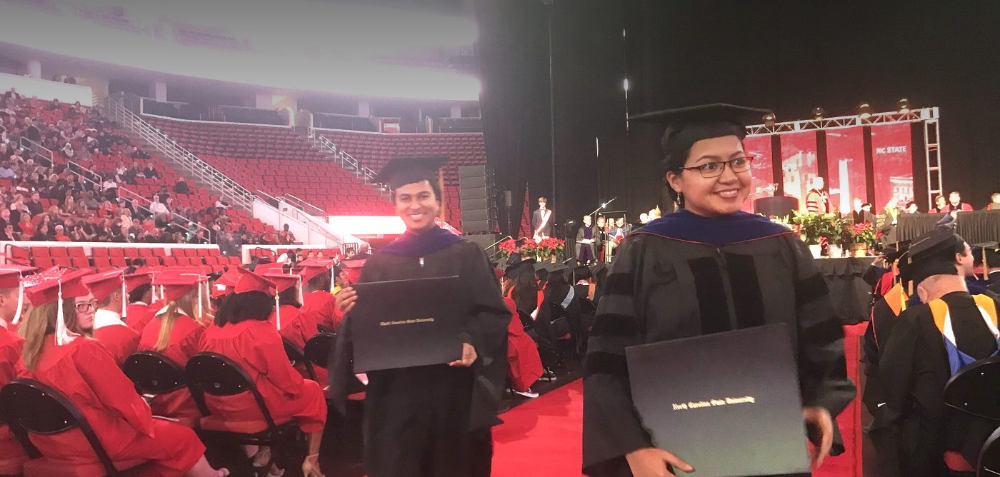
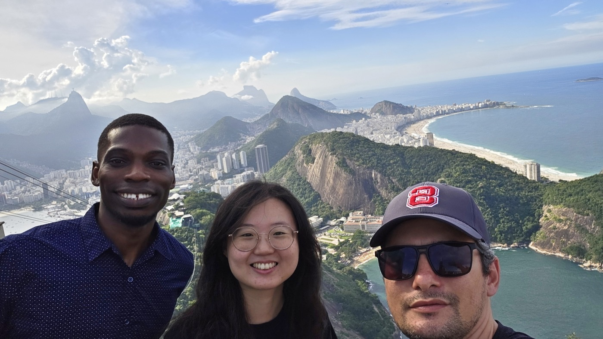
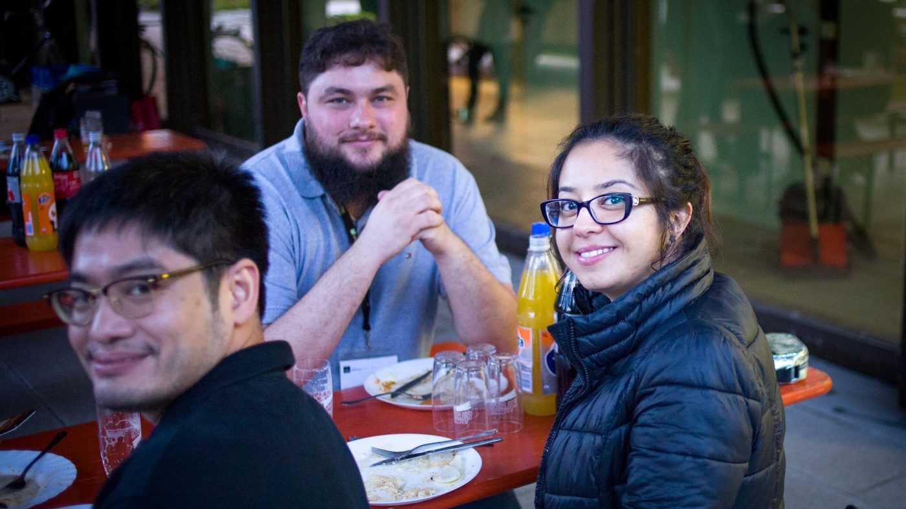
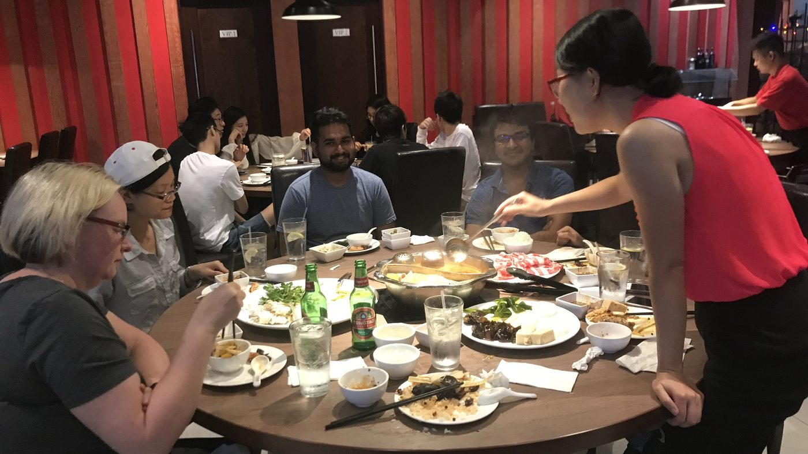
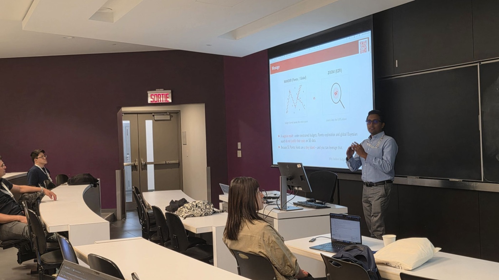
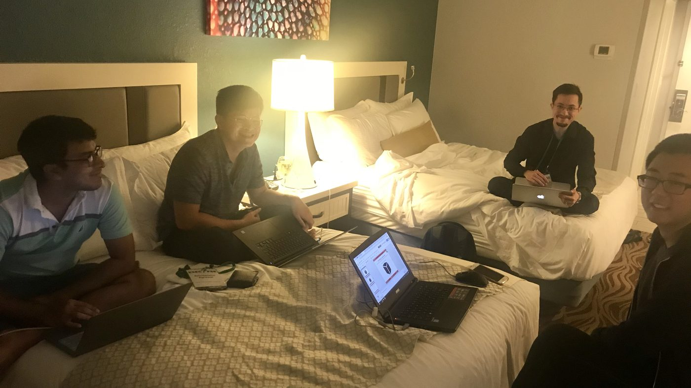
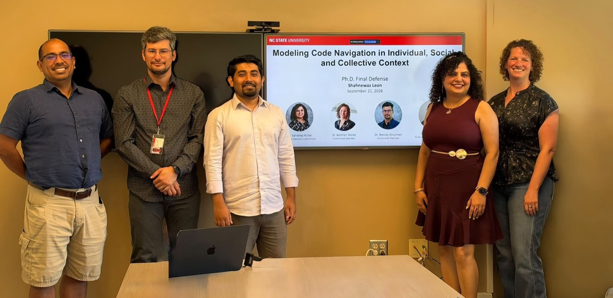



# <i class="fa-solid fa-medal" aria-hidden="true"></i> Student Life

  <figure class="on"><figcaption>PhD graduation day</figcaption></figure>
  <figure><figcaption>Above Rio, between ICSE 2026 sessions</figcaption></figure>
  <figure><figcaption>Lunch between conference sessions</figcaption></figure>
  <figure><figcaption>Group dinner</figcaption></figure>
  <figure><figcaption>Kishan Kumar Ganguly presents Zoom, Don't Wander at SSBSE 2026</figcaption></figure>
  <figure><figcaption>Deadline night: hacking in a conference hotel room</figcaption></figure>
  <figure><figcaption>Shahnewaz Leon's PhD defense, September 2026</figcaption></figure>
  <button type="button" class="marquee-arrow prev" aria-label="Previous photo">&#10094;</button>
  <button type="button" class="marquee-arrow next" aria-label="Next photo">&#10095;</button>
  



Our students defend PhDs, win paper awards, intern on three
continents, and occasionally climb a mountain. Highlights by lab
(every lab: send us your wins!).
Who's who, lab by lab, with photos: the [student directory](directory.html).

| <i class="fa-solid fa-flask badge40" aria-hidden="true"></i> labs | <i class="fa-solid fa-user-graduate badge40" aria-hidden="true"></i> alumni | <i class="fa-solid fa-briefcase badge40" aria-hidden="true"></i> internships |
|----------------|---------------|--------------|
| [HFXE Lab](#hfxe) (Sandeep Kuttal)[The Evolve Group](#evolve) (Wesley Assunção)[Irrational Research Lab](#irl) (Tim Menzies)[SoftMax Lab](#softmax) (Bowen Xu) | Our students go **EVERYWHERE**.See [where they are now](alumni.html). | Industry chases our students for summer positions.See [who went where](internships.html). |
{: .hero}

## Apply for grad school
{: #apply}

PhD (and all international) applications for Fall are due
**December 15**, recommendation letters included. US master's: May 1
for Fall, October 15 for Spring. Full list:
[CSC application deadlines](https://csc.ncsu.edu/academics/graduate/application-deadlines/).

## HFXE Lab (Sandeep Kuttal), 2026
{: #hfxe}

- Shandler Mason earned her PhD and joined Norfolk State as
  tenure-track faculty
  ([feature](https://engr.ncsu.edu/news/2026/04/29/shandler-mason-human-centered-software-engineering/){: aria-label="feature: Shandler Mason joins Norfolk State faculty"});
  her remote-collaboration paper took an **Honorable Mention at
  ACM DIS 2026**
  ([NC State News](https://news.ncsu.edu/2026/05/improving-online-collaboration/)).
- Shahnewaz Leon defended his PhD; his "Where Will They Click
  Next?" earned an **Honorable Mention at ACM CHI 2026**
  ([feature](https://csc.ncsu.edu/2026/04/shahnewaz-leon-sandeep-kuttal-receive-honorable-mention-at-acm-chi/){: aria-label="feature: Shahnewaz Leon, CHI 2026 Honorable Mention"}).
- Sandeep Sthapit defended his PhD and joined a liberal arts
  college as teaching faculty.
- Saba Khanmohammadi finished her master's, stayed for the PhD
  ([feature](https://csc.ncsu.edu/2026/10/saba-khanmohammadi-from-masters-to-ph-d/){: aria-label="feature: Saba Khanmohammadi, IBM internships"}),
  won a **Provost Doctoral Fellowship**, and interned at IBM —
  twice.
- Manali Tekes completed an international internship in Germany
  ([feature](https://csc.ncsu.edu/2026/10/manali-tekes-internship-abroad/){: aria-label="feature: Manali Teke, internship in Germany"});
  lab students presented **seven papers at HCII 2026**.

## The Evolve Group (Wesley Assunção)
{: #evolve}

Evolve students presented at ICSE 2026 in Rio — see the
[front page](./).

## Irrational Research Lab (Tim Menzies), 2026
{: #irl}

Small models, sharp answers: [IRL](https://timm.fyi/irl.html)
studies the uncomfortable finding that smaller, interpretable
models repeatedly match or beat larger ones on real SE tasks.

- [Amirali Rayegan](https://amiiralii.github.io/) (PhD candidate)
  leads the lab's work on explanation &mdash; can causal methods
  make software analytics more stable and trustworthy? His
  [Explaining Optimization Heuristics](https://arxiv.org/abs/2509.08667)
  appeared in **JSS 2026**, and he spoke on shaky causal
  structures at **ICSE 2026**.
- [Kishan Kumar Ganguly](https://github.com/KKGanguly) (PhD
  candidate) leads optimization and testing: simple,
  sample-efficient optimizers that beat complex ones
  ([Zoom, Don't Wander](https://arxiv.org/pdf/2605.09658),
  **SSBSE 2026**) and
  [data-centric fuzzing for JavaScript engines](https://arxiv.org/abs/2512.18102)
  (**IST 2026**).
- [Srinath Srinivasan](https://srina1h.github.io/) (PhD candidate)
  leads agentic systems &mdash; how far can lightweight LLM agents
  go without drowning in compute?
  [Beyond the Prompt](https://arxiv.org/abs/2602.02752) appeared at
  **MSR 2026**.
- Kishan and Srinath co-wrote
  [Can AI be Easy? Lessons Learned from the EZR.py Toolkit](https://timm.fyi/ezr.html)
  (**SPE 2026**); the lab's [MOOT](https://github.com/timm/moot)
  benchmark (120+ optimization tasks) appeared at **MSR 2026**.
- Want in? The lab's semester-long
  [reading group](https://timm.fyi/teach.html#reading-group) is
  open to NC State students and industrial partners.

## SoftMax Lab (Bowen Xu)
{: #softmax}

[SoftMax](https://ncsu-softmax.github.io/) works on trustworthy AI
for software engineering: human-AI collaboration, robustness and
privacy of code LLMs, backdoor and vulnerability detection. This
year the lab took an **ACM SIGSOFT Distinguished Paper Award at
ICPC 2026** and an **IEEE TCSE Distinguished Paper Award at ICSME
2026** (see [papers](pubs.html)).

## Your lab here

Five more labs' worth of wins belong on this page. Faculty: drop
items in the intray.
